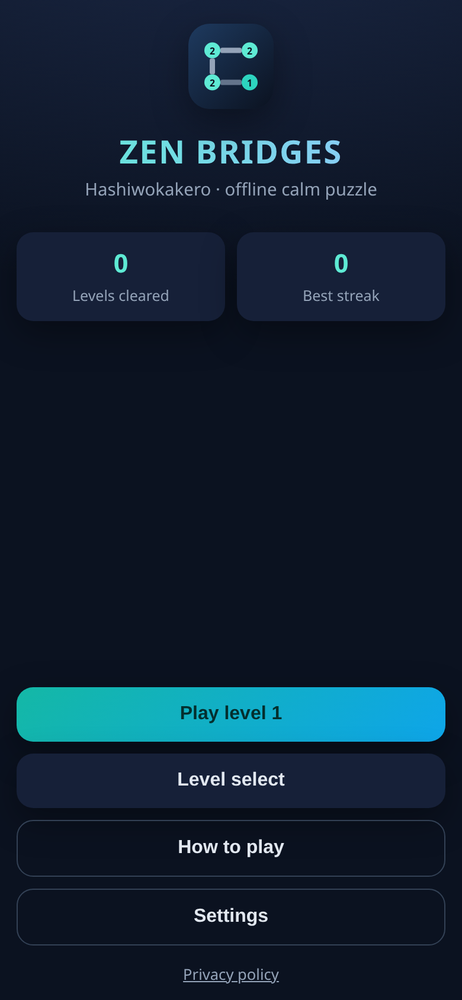
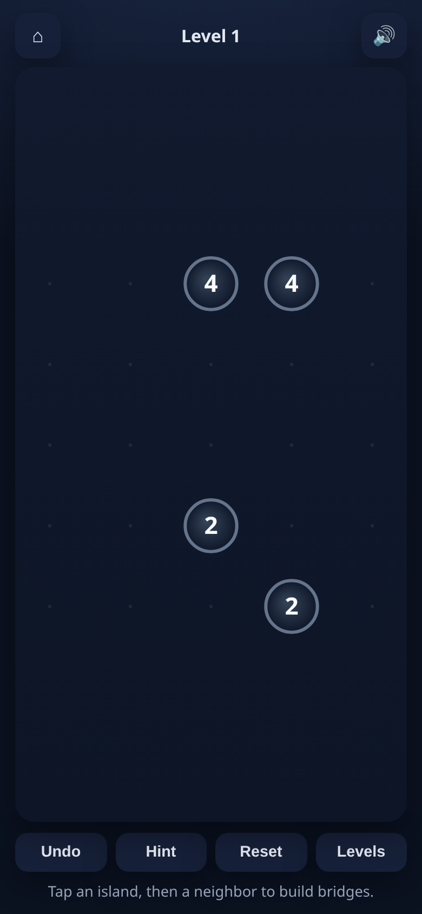
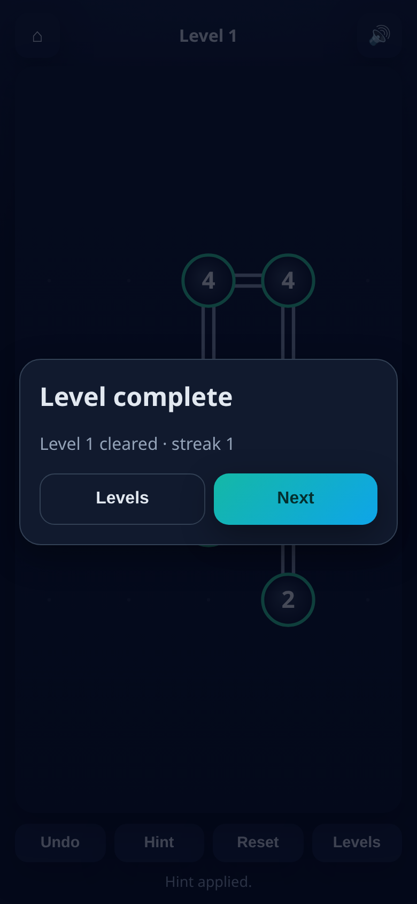
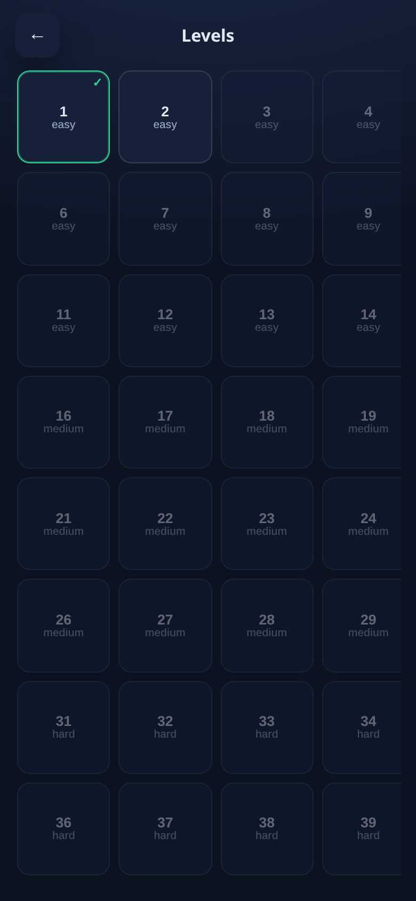

# 🌉 Zen Bridges (Hashi)

Calm, **offline Hashiwokakero** — connect numbered islands with bridges. Vanilla HTML/CSS/JavaScript, **Capacitor Android**, GitHub Pages live demo, and Actions-built debug APK.

**▶ Play live:** https://offerpk.github.io/hashi-bridges/  
**Privacy:** https://offerpk.github.io/hashi-bridges/privacy.html  
**APK artifacts:** see [Actions](https://github.com/OfferPk/hashi-bridges/actions/workflows/android.yml)

<p align="center">
  
  
  
  
</p>

## How to play

- Islands show a number — that many bridge ends must touch them.
- Tap an island, then another in the **same row or column** (clear path) to cycle **0 → 1 → 2** bridges.
- Bridges never **cross** and never pass through islands.
- You win when every island is exact **and** the whole network is connected.
- **Undo**, **Hint**, **Reset**, sequential level unlock, sound toggle, progress in `localStorage`.

## Features

- **40** generated & solver-verified levels (easy → hard)
- Pure rules module (`www/js/logic.js`) with unit tests + backtracking solver/hints
- WebAudio SFX (no audio assets), responsive mobile UI, PWA manifest + icons
- Capacitor 8 Android project committed; AdMob stubs use **Google official test IDs only**
- GitHub Actions: CI tests, Pages deploy, debug APK artifact

## Project layout

```
www/                 ← game + Pages site + Capacitor webDir
  js/logic.js        ← pure Hashi rules / solver
  js/levels.js       ← 40-level pack
  js/game.js         ← UI
  js/sound.js ads*.js
android/             ← Capacitor Android
test/logic.test.js
.github/workflows/   ← pages.yml, android.yml, ci.yml
store/listing-en.md  ← Play Store draft
```

## Run locally

```bash
npm install
npm test
npm run serve   # http://localhost:8080
```

## Ads

Development uses Google's [official test AdMob IDs](https://developers.google.com/admob/android/test-ads). Replace in `www/js/ads-config.js` (and the Android App ID meta) before production. Never commit real live units in this automation pipeline.

## License

MIT © OfferPk
